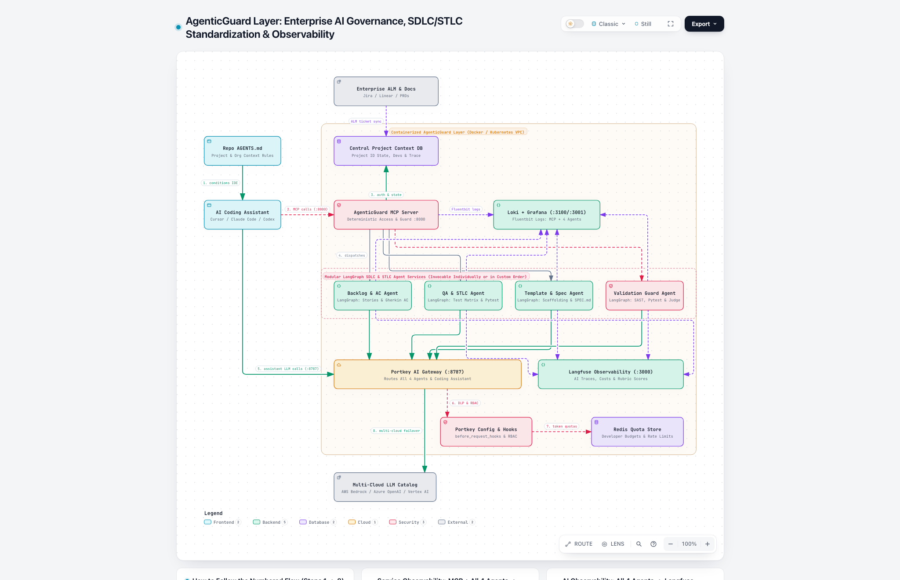

# Technical Architecture & System Design
## Product: AgenticGuard Layer
**Smallest Credible Product Strategy: Open-Source `portkey-ai/gateway` + Containerized `LangGraph` SDLC/STLC Agents via MCP + Central Project Context DB (`project_id`) + `Langfuse` & In-Agent `Fluentbit -> Loki -> Grafana` Observability**

> **Interactive Architecture Diagram**: Open [agenticguard-layer.html](./agenticguard-layer.html) in your browser (includes **4 Interactive Guided Views** in the top toolbar to step through the architecture layer-by-layer), or view the embedded diagram in Section 3.1 below.
> **Runnable Functional Prototype**: Located in [`deliverables/Functional Prototype/`](../Functional%20Prototype/).

---

## Executive Summary: AgenticGuard in 60 Seconds (For Both Non-Technical & Technical Readers)

> **The Plain-English Analogy**:
> Developers already have powerful AI coding assistants (`Cursor`, `Claude Code`, `Codex`, `GitHub Copilot`)—think of these as **high-speed sports cars**. Building another coding assistant from scratch would mean trying to manufacture a competing car against billion-dollar incumbents.
>
> Instead, **AgenticGuard Layer** builds the **Air Traffic Control, Road Rules, and Safety Inspection Gates** around the assistants your developers already love. It ensures every developer on a project follows the same requirements, passes automated quality and security checks before code is merged, never leaks company secrets to external AI providers, and stays within budget.

| Business Pillar | Plain-English Value (For Product & Leadership) | Technical Implementation (For Engineers & Architects) |
| :--- | :--- | :--- |
| **1. Process & Quality Standardization** | Turns raw tickets into clear requirements, QA tests, and code templates *before* coding starts, and blocks unsafe code *before* merge. | **Repo `AGENTS.md`** + **Deterministic MCP Server (`:8000`)** + **4 Modular `LangGraph` Agents** (`Backlog & AC`, `QA & STLC`, `Template & Spec`, `Validation Guard`). |
| **2. Team Alignment & Project Visibility** | Keeps multiple developers on the same project in sync and shows who is building which feature in real time (complementing Git). | **Central Project Context DB (`PostgreSQL` keyed by `project_id`)** storing shared specs, allowed developers (`project_developers`), and live branch/stage tracking (`developer_work_state`), synced with **Enterprise ALM (`Jira`/`Linear`)**. |
| **3. Security, Cost Control & No Lock-In** | Blocks leaked passwords/PII, enforces daily AI budgets per developer, and switches cloud AI vendors automatically if an outage occurs. | **Portkey AI Gateway (`:8787`)** routing **100% of LLM calls** (from both the Coding Assistant and all 4 Agents) through **Portkey Config & Hooks (DLP/RBAC)** + **Redis Quota Store** to the **Multi-Cloud LLM Catalog** (`Bedrock` / `Azure` / `Vertex`). |
| **4. Unified ROI & Health Visibility** | Shows leadership exact AI cost per delivered feature, which coding assistant performs best, and real-time security/service health. | **Dual Observability**: **Langfuse (`:3000`)** for AI agent traces, token spend, and quality scores + embedded **Fluentbit $\rightarrow$ Loki (`:3100`) $\rightarrow$ Grafana (`:3001`)** for service logs across MCP and all 4 Agents. |

---

## 1. Understand the Problem

### Should We Build Another AI Coding Assistant?
**No.** Developers already use capable AI coding assistants (`Cursor`, `Claude Code`, `Codex`, `GitHub Copilot`). Building a competing IDE or training a proprietary coding LLM is capital-inefficient.

However, enterprise engineering teams face **five critical gaps** when using these coding assistants in real projects:

1. **No SDLC & STLC Process Standardization**:
   - *Technical Reality*: Coding assistants translate chat prompts into code, but they do not standardize upstream **Backlog & Acceptance Criteria** (synced with Jira/Linear), **QA Test Case generation**, or **Project Template & Spec scaffolding**, nor do they enforce a downstream **Validation Gate** before merge.
   - *Business Impact*: Features are built against vague prompts without matching tests, increasing QA rework and escaped bugs.
2. **Multi-Developer Context Drift & Missing Traceability (No Complement to Git)**:
   - *Technical Reality*: Coding assistants run in isolated local silos. Git tracks file commits, but it does **not** centralize by `project_id` the shared project context, the list of **allowed developers on that project**, or **real-time developer-to-feature/backlog state** (which developer is actively working on which story/feature and which SDLC stage they are in).
   - *Business Impact*: Developers on the same project unintentionally generate conflicting patterns (**intra-project drift**), and repositories diverge from company standards (**inter-project drift**).
3. **Model Lock-In & Fragmented Catalogs**:
   - *Technical Reality*: Some assistants lock teams into one vendor's models, while others offer a limited catalog. Enterprises need a single control point to route all AI traffic across their approved multi-cloud providers (`AWS Bedrock`, `Azure OpenAI`, `GCP Vertex AI`).
   - *Business Impact*: Vendor outages halt engineering productivity, and teams cannot easily route simpler tasks to cheaper models.
4. **Missing Quotas, Permissions, and Outbound Data Controls**:
   - *Technical Reality*: Enterprises lack a single interception layer to control which developer roles can use expensive models, enforce per-developer token budgets, and block secrets (`.env`, API keys) or customer PII from being sent to external LLMs.
   - *Business Impact*: Unpredictable cloud AI bills and severe compliance/data-leakage risks.
5. **Lack of Unified AI & Service Observability**:
   - *Technical Reality*: Leadership lacks unified visibility into **LLM & Agent traces, token costs, and quality scores (`Langfuse`)** as well as **service logs (`Fluentbit -> Loki -> Grafana`)**.
   - *Business Impact*: Impossible to measure AI ROI (`$/Validated Story`) or make data-driven decisions on when to switch between `Cursor`, `Claude Code`, or `Codex`.

---

## 2. Define Your Differentiated Product

### 2.1 Primary Problem Solved (Core Value Proposition)
**AgenticGuard Layer** is a lightweight, containerized **Enterprise Governance, Observability & SDLC/STLC Standardization Layer** that complements existing AI coding assistants through four core elements:

1. **Unified AI Gateway Plane (`portkey-ai/gateway` on `:8787`)**:
   Intercepts **100% of LLM calls** from **both** the developer's AI Coding Assistant (`Cursor`, `Claude Code`, `Codex`) and all four `LangGraph` SDLC/STLC agents. Enforces role-based model routing, Redis token quotas, and deterministic pre-flight DLP guardrails (`before_request_hooks`).
2. **Deterministic MCP Access & Guardrail Server (`:8000`) + Modular `LangGraph` SDLC & STLC Agent Services**:
   - **Deterministic MCP Server (`:8000`)**: A deterministic security & access-control service that sits in front of the agents when the AI Coding Assistant calls MCP tools. It verifies whether the developer is authorized in `project_id`, enforces deterministic input/output guardrails, and updates the Central DB.
   - **4 Modular `LangGraph` (`StateGraph`) Agent Services**: Invocable **individually or in any custom order** through the MCP Server:
     - **`backlog_ac` (`Backlog & AC Agent`)**: Generates Backlog Stories + Gherkin Acceptance Criteria from docs and syncs bi-directionally with ALMs (`Jira` / `Linear` / `Azure DevOps`).
     - **`qa_stlc` (`QA & STLC Agent`)**: Generates the STLC Test Matrix and executable `pytest` contract stubs from Acceptance Criteria.
     - **`template_spec` (`Template & Spec Agent`)**: Generates *only* the project template scaffolding, interface signatures, `SPEC.md`, and `AGENTS.md` rules (leaving business-logic coding to the developer's AI Coding Assistant).
     - **`validation_guard` (`Validation Guard Agent`)**: Runs deterministic AST/SAST/type/test checks plus an LLM Acceptance Criteria Judge, issuing a signed `X-AgenticGuard-Validation-Receipt`.
3. **Central Project Context & State Database (`PostgreSQL` Keyed by `project_id`)**:
   Connected to all 4 agents via the MCP Server. Centralizes by `project_id`:
   - Shared project architecture context, corporate standards, and all stage outcomes (`Backlog/AC`, `QA Tests`, `SPEC.md`, `Validation Receipts`).
   - **Allowed Project Developers (`project_developers`)**: Controls which developers are authorized in each project.
   - **Developer-to-Feature Traceability (`developer_work_state`)**: Complements Git by tracking in real time which developer is working on which feature/backlog item, their active Git branch/commit ref, and current SDLC stage.
4. **Two-Layer Containerized Observability (`Langfuse` + In-Agent `Fluentbit -> Loki -> Grafana`)**:
   - **AI & Agent Observability (`Langfuse` on `:3000`)**: All **4 `LangGraph` Agent Services connect directly to `Langfuse`** via `langfuse.langchain.CallbackHandler()` (and `langfuse.openai` SDK) to record agent graph traces, prompts, and validation rubric scores directly. In addition, **Portkey AI Gateway** exports OpenTelemetry (`OTel`) spans (`trace_id` / `x-portkey-metadata`) to Langfuse so both direct Coding Assistant calls and Agent LLM calls are correlated.
   - **Service Observability (`Fluentbit` Library $\rightarrow$ `Loki :3100` $\rightarrow$ `Grafana :3001`)**: An embedded **Fluentbit logging library inside both the MCP Server and all 4 Agent Services** captures structured service logs and sends them directly to **Loki**, where they are visualized in **Grafana**.

### 2.2 What We Deliberately Do Differently
- **Complement Instead of Compete**: Our `template_spec` agent generates *only* the project template, function signatures, and `SPEC.md`. The developer's existing AI Coding Assistant writes the application business logic against those specs and QA tests.
- **Modular Execution (Individual or Custom Order)**: Using `LangGraph` conditional routing, teams can trigger a single agent standalone (e.g., only `qa_stlc` or only `validation_guard`) or run any custom sequence.
- **Compose Proven Open-Source Components**: We compose `portkey-ai/gateway`, `LangGraph`, `Langfuse`, and `Fluentbit + Loki + Grafana` so a small team (2–4 engineers) focuses 100% on the SDLC/STLC agents, Central DB, and governance policies.

### 2.3 Attractive Features Explicitly Left Out
1. **No Custom IDE or Chat UI**: We integrate via `BASE_URL` overrides, **MCP**, and repository **`AGENTS.md`** files.
2. **No Proprietary Model Training**: We route across `AWS Bedrock`, `Azure OpenAI`, and `GCP Vertex AI` via Portkey.
3. **No Full-Codebase Vector Indexing**: Coding assistants index local code; our Central DB stores structured project context, allowed developers, feature traceability, specs, and test contracts by `project_id`.

### 2.4 Why Organizations Supplement Existing Assistants With AgenticGuard Layer
- **Keep Developer Choice with Full Enterprise Control**: Developers keep Cursor or Claude Code, while the company gets centralized model routing, quotas, and DLP.
- **Alignment Across Developers & Projects**: `AGENTS.md` + the **Central DB (`project_id`)** keep every developer on a project aligned and provide Git-complementary traceability of who is building what.
- **Data to Switch Assistants Anytime**: **Langfuse** compares cost and validation pass rates across `Cursor`, `Claude Code`, and `Codex`.

---

## 3. Design the System

### 3.1 System Architecture Diagram & Step-by-Step Walkthrough (`Steps 1 -> 8`)

> **Tip for Live Presentations**: Open [agenticguard-layer.html](./agenticguard-layer.html) and click the **4 Guided View pills** in the top bar (**`1. IDE & MCP Gate`**, **`2. Modular SDLC/STLC Agents`**, **`3. Portkey AI Gateway (:8787)`**, **`4. Dual Observability`**) to spotlight each layer interactively with animated flow traces.

#### How to Follow the Diagram (Follow the Numbered Arrows `1 -> 8` from Left-to-Right, Top-to-Bottom)

1. **Step `1. conditions IDE` (`Repo AGENTS.md` $\rightarrow$ `AI Coding Assistant`)**:
   When a developer opens the repository in **Cursor**, **Claude Code**, or **Codex**, the repo's **`AGENTS.md`** file automatically instructs the assistant on corporate engineering standards, required Portkey headers, and available MCP tools.
2. **Step `2. MCP calls (:8000)` (`AI Coding Assistant` $\rightarrow$ `AgenticGuard MCP Server`)**:
   Instead of calling agents directly, the assistant sends tool requests to the **AgenticGuard MCP Server (`:8000`)**—a deterministic security and access-control gate inside the VPC.
3. **Step `3. auth & state` (`AgenticGuard MCP Server` $\rightarrow$ `Central Project Context DB` $\leftarrow$ `Enterprise ALM & Docs`)**:
   The MCP Server checks the **Central Project Context DB (`PostgreSQL`)** to verify that the developer is authorized on `project_id`, retrieves shared project context/tickets synced from **Enterprise ALM & Docs (`Jira`/`Linear`)**, and records which feature and Git branch the developer is actively working on.
4. **Step `4. dispatches` (`AgenticGuard MCP Server` $\rightarrow$ `4 Modular LangGraph Agents`)**:
   Once authorized, the MCP Server dispatches any individual `LangGraph` agent or custom sequence:
   - **`Backlog & AC Agent`** (Stage 1 — Stories & Gherkin Acceptance Criteria)
   - **`QA & STLC Agent`** (Stage 2 — Test Matrix & executable `pytest` stubs)
   - **`Template & Spec Agent`** (Stage 3 — Code scaffolding & `SPEC.md` only)
   - **`Validation Guard Agent`** (Stage 4 — Deterministic SAST/AST/`pytest` + LLM Rubric Judge before merge)
5. **Step `5. assistant LLM calls (:8787)` & Agent LLM Calls (`AI Coding Assistant` + `All 4 Agents` $\rightarrow$ `Portkey AI Gateway :8787`)**:
   Follow the **5 solid green arrows** converging into **Portkey AI Gateway (`:8787`)**: **all 4 `LangGraph` Agents** (straight down from Row 3) **AND** the developer's **AI Coding Assistant** (along the left channel) route **100% of their LLM requests** through Portkey.
6. **Step `6. DLP & RBAC` (`Portkey AI Gateway` $\rightarrow$ `Portkey Config & Hooks`)**:
   Before any prompt leaves the VPC, Portkey executes deterministic `before_request_hooks` to block secrets (`AKIA...`, `sk-...`, `.env` files) and PII (`HTTP 446`), and enforces role-based model permissions.
7. **Step `7. token quotas` (`Portkey Config & Hooks` $\rightarrow$ `Redis Quota Store`)**:
   Portkey checks and decrements the developer's daily token budget in **Redis** so a runaway loop cannot exhaust team spend.
8. **Step `8. multi-cloud failover` (`Portkey AI Gateway` $\rightarrow$ `Multi-Cloud LLM Catalog`)**:
   Approved prompts are routed to the enterprise's **Multi-Cloud LLM Catalog** (`AWS Bedrock`, `Azure OpenAI`, `GCP Vertex AI`) with automatic retry and cross-cloud failover.
9. **Dashed Purple Observability Flows (Non-Blocking Telemetry)**:
   - **Service Observability (`MCP Server` + `All 4 Agents` $\rightarrow$ `Loki + Grafana :3100/:3001`)**: All 5 services ship structured container and security logs via their embedded **Fluentbit** library upward into **Loki + Grafana**.
   - **AI Observability (`All 4 Agents` $\rightarrow$ `Langfuse Observability :3000`)**: All 4 `LangGraph` agents stream multi-step agent traces, prompt versions, token costs, and validation rubric scores downward into **Langfuse**.

---

#### Complete 15-Component Reference (Plain-English Role vs. Technical Specification)

| # | Component in Diagram | Location / Layer | Plain-English Role (For Non-Technical Attendees) | Technical Specification (For Technical Attendees) |
| :- | :--- | :--- | :--- | :--- |
| **1** | **`Repo AGENTS.md`** | Developer Workspace (Left) | The "rulebook" inside the code folder that tells the AI assistant how to behave. | Markdown conditioning rules defining `PORTKEY_GATEWAY_URL`, MCP endpoints, and coding standards. |
| **2** | **`AI Coding Assistant`** | Developer Workspace (Left) | The AI tool the developer types into (`Cursor`, `Claude Code`, or `Codex`). | Local IDE harness configured with `BASE_URL=http://localhost:8787/v1` and MCP client (`:8000`). |
| **3** | **`Enterprise ALM & Docs`** | External Input (Top) | Where product managers write tickets and requirements (`Jira`, `Linear`, PRDs). | Bi-directional REST/Webhook sync of story IDs, Acceptance Criteria, and validation receipts. |
| **4** | **`Central Project Context DB`** | VPC — Data Layer (Row 1) | The "shared team memory" that tracks project specs, who is allowed on the project, and who is building what. | `PostgreSQL` keyed by `project_id` (`project_context`, `project_developers`, `developer_work_state`, `stage_outcomes`). |
| **5** | **`AgenticGuard MCP Server`** | VPC — Access Gate (`:8000`, Row 2) | The "security checkpoint" that verifies developer permissions before running any workflow agent. | Deterministic JSON-RPC/SSE MCP server enforcing `project_id` RBAC and schema validation. |
| **6** | **`Loki + Grafana`** | VPC — Observability (`:3100/:3001`, Row 2) | The "system health dashboard" showing security blocks, errors, and service logs. | Receives structured JSON logs via embedded `Fluentbit` from MCP Server + all 4 `LangGraph` agents. |
| **7** | **`Backlog & AC Agent`** | VPC — LangGraph Stage 1 (Row 3) | Translates rough product notes into clear user stories and testable rules. | `LangGraph` node generating standardized stories + Gherkin `Given/When/Then` Acceptance Criteria. |
| **8** | **`QA & STLC Agent`** | VPC — LangGraph Stage 2 (Row 3) | Automatically writes the test plan and starter automated tests before code is written. | `LangGraph` node generating STLC Test Matrix (happy, edge, security) + executable `pytest` stubs. |
| **9** | **`Template & Spec Agent`** | VPC — LangGraph Stage 3 (Row 3) | Creates the empty code blueprint and contract so the developer's AI assistant can fill in the logic. | `LangGraph` node generating *only* file scaffolding, typed function signatures, and `SPEC.md`. |
| **10** | **`Validation Guard Agent`** | VPC — LangGraph Stage 4 (Row 3) | The "final inspector" that checks security, runs tests, and signs off before code can be merged. | Deterministic AST/SAST/`pytest` runner + LLM Rubric Judge issuing signed `X-AgenticGuard-Validation-Receipt`. |
| **11** | **`Portkey AI Gateway`** | VPC — LLM Control Plane (`:8787`, Row 4) | The "single tollbooth" that every AI request (from both the IDE and all 4 agents) must pass through. | Self-hosted `portkey-ai/gateway` routing 100% of LLM calls with OTel trace propagation. |
| **12** | **`Langfuse Observability`** | VPC — AI Observability (`:3000`, Row 4) | The "AI analytics center" tracking AI costs per feature, prompt quality, and assistant comparisons. | Direct `langfuse.langchain.CallbackHandler` integration from all 4 `LangGraph` agents + Portkey OTel spans. |
| **13** | **`Portkey Config & Hooks`** | VPC — Security Policy (Row 5) | The "filter" that blocks passwords, API keys, or private data from leaving the company. | Deterministic `before_request_hooks` (regex/entropy secret & PII redaction returning `HTTP 446`) + model RBAC. |
| **14** | **`Redis Quota Store`** | VPC — Quota Store (Row 5) | The "spending meter" that enforces daily AI budgets per developer and team. | Low-latency Redis counters tracking daily token consumption and rate limits by `user_id` / `user_group`. |
| **15** | **`Multi-Cloud LLM Catalog`** | External Cloud Providers (Bottom) | The cloud AI brains (`AWS Bedrock`, `Azure OpenAI`, `Google Vertex AI`) used to generate responses. | Multi-cloud model endpoints with automated Portkey fallback (`claude-sonnet-4` $\rightarrow$ `gpt-4.1` / `gemini-2.5-flash`). |

---

### 3.2 Key Technical Decisions Across the 8 Assessment Dimensions

| Dimension | Technical Decision in AgenticGuard Layer |
| :--- | :--- |
| **1. Model Strategy & Context Management** | **100% LLM Routing via `portkey-ai/gateway` (`:8787`)**: Both the Coding Assistant and all 4 `LangGraph` agents consume models (`claude-sonnet-4` on Bedrock $\rightarrow$ `gpt-4.1` fallback on Azure; `gemini-2.5-flash` / `haiku-3.5` for fast checks) via Portkey `x-portkey-config`. Shared context is fetched by `project_id` from the **Central DB** in a canonical format that preserves prompt caching. |
| **2. Repository Understanding & Git Traceability** | **Repo `AGENTS.md` + Central DB (`project_id`)**: `AGENTS.md` conditions the local assistant on repo boundaries and MCP tools. The Central DB complements Git by tracking `project_developers` (allowed developers per `project_id`) and `developer_work_state` (which developer is working on which feature/story, active Git branch, and stage). |
| **3. Tool Execution & Permissions** | **Two-Tier Permissions**: (1) Project-level authorization in the Central DB (`is_developer_allowed_in_project(project_id, developer_id)`); (2) Gateway-level model RBAC and daily Redis token quotas via `x-portkey-metadata`. |
| **4. Agent Orchestration (`LangGraph` via MCP)** | **Modular `StateGraph(SDLCGraphState)`**: Built with `LangGraph` conditional edges (`add_conditional_edges`) so developers can run any single agent standalone (`["qa_stlc"]`) or any custom sequence (`["backlog_ac", "qa_stlc", "template_spec"]`). |
| **5. Evaluation, Security & Privacy** | **Inbound DLP + Outbound Validation**: Portkey `before_request_hooks` block secrets (`AKIA...`, `sk-...`), PII, and `.env` files pre-flight (`HTTP 446`). `validation_guard` runs deterministic AST/SAST/pytest checks + an LLM Acceptance Criteria Judge, issuing a signed `X-AgenticGuard-Validation-Receipt`. |
| **6. Observability & Human Control** | **Langfuse (`:3000`) + In-Agent Fluentbit $\rightarrow$ Loki (`:3100`) $\rightarrow$ Grafana (`:3001`)**: Langfuse connects to Portkey (OTel) and LangGraph (`CallbackHandler`) for traces, costs, and rubric scores. The in-agent `Fluentbit` library captures service logs and ships them to `Loki` for `Grafana` dashboards. Human approval checkpoints are stored in the Central DB. |
| **7. Latency, Cost & Failure Handling** | **Deterministic Hot Path & Auto-Failover**: Only deterministic checks (regex DLP, RBAC, quotas) run on the request path; Langfuse and Fluentbit logging run asynchronously and fail-open. The actual latency overhead is a pilot metric, not an assumption. Portkey `retry` and `fallback` configs fail over across Bedrock, Azure OpenAI, and Vertex AI on `429`/`5xx` errors. |
| **8. Enterprise Integration** | **Bi-Directional ALM Sync & Containers**: Syncs stories, Acceptance Criteria, and validation receipts with `Jira`, `Linear`, or `Azure DevOps`. Deployed via `docker-compose.yml` / Kubernetes. |

---

### 3.3 Risks, First Prototype, Metrics & Abandonment Criteria

#### 1. Largest Technical Risks & Assumptions
- **Risk 1 (Assistant ignores `AGENTS.md` or bypasses `BASE_URL`)**: Mitigated via a local Git `pre-commit` hook and CI PR gate that blocks merges unless a valid `X-AgenticGuard-Validation-Receipt` exists in the Central DB for that `project_id` and `story_id`.
- **Risk 2 (Generated QA tests mismatch assistant function names)**: Mitigated via **Contract-First Scaffolding**—`template_spec` generates the exact Python function signature stub alongside the `pytest` contract so the coding assistant implements behind a fixed signature.
- **Risk 3 (Observability backpressure)**: Mitigated by keeping `Langfuse` tracing and the in-agent `Fluentbit -> Loki` logger asynchronous and fail-open.

#### 2. What We Prototype First (Functional Prototype MVP)
Implemented in [`deliverables/Functional Prototype/`](../Functional%20Prototype/):
1. **[`agentic_guard/db.py`](../Functional%20Prototype/agentic_guard/db.py)**: Central DB keyed by `project_id` storing shared context, `project_developers` (allowed developers), `developer_work_state` (developer-to-feature/Git-branch traceability), ALM tickets, and stage outcomes.
2. **[`agentic_guard/gateway.py`](../Functional%20Prototype/agentic_guard/gateway.py)**: Portkey AI Gateway layer enforcing `x-portkey-config`, RBAC, quotas, `before_request_hooks` DLP, and multi-cloud fallback.
3. **[`agentic_guard/agents_mcp.py`](../Functional%20Prototype/agentic_guard/agents_mcp.py)**: Modular `LangGraph` (`StateGraph`) agents (`backlog_ac`, `qa_stlc`, `template_spec`, `validation_guard`) invocable individually or in custom order.
4. **[`agentic_guard/observability.py`](../Functional%20Prototype/agentic_guard/observability.py)**: `LangfusePortkeyTracer` + `FluentBitLokiLogger` (in-agent Fluentbit library shipping service logs to Loki for Grafana).

#### 3. What We Measure
> No baseline data exists yet. The first pilot weeks measure the team **without** the layer; targets are then set against that baseline rather than assumed.
- **First-Pass PR Validation Rate**: % of assistant implementations passing QA tests, SAST, and Acceptance Criteria on the first PR (baseline vs. with-layer).
- **Rework / Review Cycles per Story** and story cycle time.
- **Cost per Validated Story ($\$/\text{Story}$)**: Total inference spend in **Langfuse** divided by validated stories across `Cursor`, `Claude Code`, and `Codex`.
- **DLP Interception & Gateway Latency**: block rate on seeded secrets/PII and gateway latency overhead, tracked in **Grafana / Loki**.
- **Adoption**: share of assistant sessions that actually call the MCP tools.

#### 4. Evidence That Would Cause Us to Change or Abandon Our Approach
1. **Upstream Agent Friction Exceeds Rework Savings**: If manual calls to `backlog_ac -> qa_stlc -> template_spec` slow stories down without a clear lift in first-pass PR quality versus the pilot baseline, we would **switch from manual developer calls to an automated ALM webhook** that runs the upstream `LangGraph` flow automatically when a Jira ticket moves to *In Progress* — or drop them.
2. **Assistants Routinely Skip MCP Calls**: If coding assistants skip MCP calls in a significant share of sessions, we would **replace passive `AGENTS.md` conditioning with a deterministic CLI / Git pre-commit wrapper**.
3. **Vendors Ship Cross-Tool Governance at Parity**: We would **retire the gateway layer** and keep only the Central DB + SDLC/STLC agents.
4. **No Measurable Quality or Cost Difference** after the pilot: **stop**, and keep buying assistants as-is.

---

## 4. Convince the Skeptical CFO

### 4.1 Direct Executive Answer to the CFO's Challenge

> **The CFO's Question**:
> *"Microsoft, OpenAI, Anthropic and well-funded startups are already spending enormous amounts of money on this problem. Why should we believe that we can compete, and why shouldn't we simply buy their products?"*

**The Direct Recommendation**:
You are completely right—we should not spend a single dollar trying to compete with Microsoft, OpenAI, or Anthropic on building an AI coding assistant, training proprietary foundation models, or designing an IDE. **We should continue buying their products.**

**AgenticGuard Layer is not a competing coding assistant.** It is the thin, containerized governance and process-standardization layer that allows our enterprise to use *their* products safely, cost-effectively, and measurably—something none of the competing vendors is incentivized to build across their rivals' tools.

---

### 4.2 Capital Allocation Strategy: Buy vs. Compose vs. Build

| Layer | Strategic Decision | Commercial Justification (Capital Efficiency) |
| :--- | :--- | :--- |
| **Coding Assistants** (`Cursor`, `Claude Code`, `Codex`, `Copilot`) | BUY | Vendors spend billions updating editor UX, language servers, and model capabilities. We let developers keep the best tools on the market. |
| **Foundation LLMs** (`Bedrock`, `Azure OpenAI`, `Vertex AI`) | BUY | Commodity token inference consumed on-demand through our existing multi-cloud enterprise contracts. |
| **Gateway, Orchestration & Observability Plane** (`Portkey`, `LangGraph`, `Langfuse`, `Loki + Grafana`) | COMPOSE (Open-Source) | Production-grade open-source components with zero upfront software licensing costs. Fully swappable with zero vendor lock-in. |
| **Project Context DB (`project_id`), SDLC/STLC Standardization Agents, Validation Gate & Policies** | BUILD (Thin Differentiated Layer) | Highly proprietary to how *our* enterprise delivers software. No external vendor sells our internal acceptance criteria, coding standards, or cross-tool validation receipts. |

---

### 4.3 Why Organizations Cannot Simply Rely on Vendor-Native Controls

1. **Vendor Incentives Prevent Cross-Tool Governance**: Microsoft will never optimize Copilot to manage Cursor or Claude Code, nor will Anthropic build tools to compare Claude Code's cost against Codex. Enterprises need vendor-neutral leverage.
2. **Eliminating the Switching Tax**: By routing 100% of LLM calls through a central gateway (`portkey-ai/gateway`), changing from an overpriced model or assistant to a cheaper alternative is a 5-minute configuration update rather than a multi-month engineering rewrite.
3. **Protecting Downside Risk Pre-Flight**: Data-leak prevention (blocking API keys, passwords, customer PII) and hard daily token budgets are enforced uniformly across every present and future coding assistant.

---

### 4.4 A Stage-Gated, Capped Investment Bet

To protect capital and validate value empirically before scaling:

- **Phase 0 (Delivered — Functional Prototype)**: The complete control flow, deterministic gateway DLP, `LangGraph` agents, `project_id` context store, and signed validation gates are already proven end-to-end in a working prototype.
- **Phase 1 (Small Time-Boxed Pilot)**:
  - **Resource Allocation**: Capped at **2 to 4 engineers** on **one pilot team** for 6–8 weeks.
  - **Empirical Baseline First**: Measure the team's baseline first-pass PR validation rate, review cycle time, and costs *without* the layer, then measure the exact same metrics *with* the layer.
- **Hard Decision Gate (Scale, Narrow, or Kill)**:
  - **Scale**: Only if first-pass PR validation improves significantly and cost per validated story is demonstrably reduced.
  - **Narrow**: If developers find upstream agents friction-heavy, automate them via ALM webhooks or reduce the layer to the Gateway + Validation Guard.
  - **Kill**: If empirical pilot metrics show no measurable quality or cost difference, **stop immediately** and continue buying commercial assistants as-is.

---

### 4.5 Defending the Recommendation Against Anticipated Pushback

| Anticipated Executive Pushback | Strategic Defense |
| :--- | :--- |
| *"Vendors will eventually ship governance features anyway."* | They will—inside their own proprietary silos. Cross-tool governance across rivals is structurally opposed to their business models. Furthermore, if a vendor achieves full parity, our written kill criteria automatically retires our gateway and retains only our internal standards DB. |
| *"Isn't this just Portkey with extra steps?"* | Portkey is the gateway component for model routing and quotas. The core IP and enterprise value we build is the **Central Context DB by `project_id`**, standardized **SDLC/STLC agent contracts**, and **tamper-evident validation receipts** tied to Jira/Linear requirements. |
| *"Developers will simply bypass the gateway."* | Compliance is enforced at two deterministic choke points: (1) VPC network egress policies restrict LLM endpoints to the Portkey gateway; (2) CI/CD merge gates reject any Pull Request lacking a cryptographically signed `X-AgenticGuard-Validation-Receipt`. |
| *"Why not buy a commercial enterprise AI-governance SaaS platform?"* | We will evaluate them during the pilot. Commercial governance platforms cover generic policy routing, but they do not standardize repository templates, generate QA test matrices, or verify code against custom Gherkin Acceptance Criteria. Composing open-source first protects capital and avoids long SaaS lock-in contracts. |

